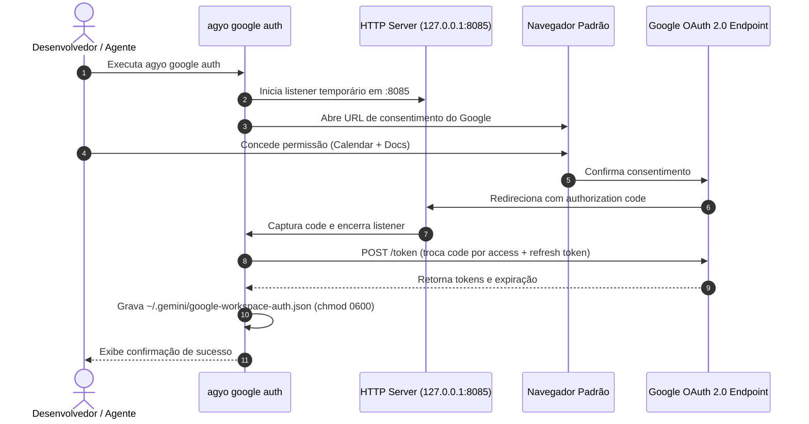

# Especificação Canônica 10: Google Workspace Bridge (Calendar & Docs)

> **Status:** Ativa · **Dono:** Tiago Vilas Boas  
> **Localização:** `internal/workspace/` · **CLI:** `agyo google` (alias `agyo gsuite`)  
> **Padrão Arquitetural:** Outer Harness (Guia x Sensor) · Pure Go stdlib (Zero External Deps)

---

## 1. Visão Geral e Motivação

O **`agyo`** já opera com excelência como motor de execução local (Terminal, Git, Filesystem e Browser via Chrome CDP) e como Cérebro de Pesquisa multimodal (via Google NotebookLM).

No entanto, o fluxo diário de engenharia e estudos de um desenvolvedor Staff ou pesquisador envolve duas entidades primordiais externas ao repositório git:
1. **Tempo e Compromissos (Google Calendar):** Reuniões de alinhamento, blocos de foco de código (deep work), prazos de faculdade e entregas de sprints.
2. **Documentação e Síntese (Google Docs):** Atas de decisão, RFCs de arquitetura, roteiros de estudo, artigos técnicos e minutas.

Inspirado no modelo de conectores de ferramentas do Codex e do Claude Code, a **Spec 10** define a ponte nativa em Go puro entre o `agyo` e as APIs REST do **Google Workspace (Google Calendar API v3 e Google Docs API v1)**, expondo comandos CLI amigáveis para humanos e ferramentas estruturadas para agentes via servidor **MCP (Model Context Protocol)**.

---

## 2. Princípios de Engenharia

1. **Zero External Dependencies (Pure Go Standard Library):**
   * Toda a comunicação HTTP, serialização JSON e servidor loopback de OAuth2 é implementada usando exclusivamente a biblioteca padrão do Go (`net/http`, `crypto/rand`, `crypto/sha256`, `encoding/json`, `time`, `os`).
2. **Segurança e Armazenamento Local de Credenciais:**
   * Tokens de acesso e refresh tokens são salvos exclusivamente no diretório de configuração do usuário (`~/.gemini/google-workspace-auth.json`) com permissões estritas `0600` (leitura e escrita apenas pelo dono do processo).
   * O cliente nunca expõe ou versiona credenciais em repositórios git.
3. **Fronteiras e Separação de Contextos:**
   * Em conformidade com a diretriz de governança de contextos (`organizar-contextos`), o conector permite chavear ou identificar o contexto de destino para evitar contaminação entre contas corporativas e contas pessoais de estudo.
4. **Interface Dual-Mode (CLI + MCP):**
   * Saída legível e escaneável para humanos no terminal (badges, formatação de horários).
   * Saída JSON limpa (`--json`) e ferramentas MCP para consumo determinístico por agentes de IA.

---

## 3. Fluxo de Autenticação OAuth 2.0 (Loopback Local)



### Escopos Mínimos Solicitados:
* `https://www.googleapis.com/auth/calendar.events` (Leitura e criação de eventos na agenda)
* `https://www.googleapis.com/auth/documents` (Leitura e criação de documentos no Google Docs)
* `https://www.googleapis.com/auth/drive.file` (Acesso apenas aos arquivos criados pelo app)

---

## 4. Contrato da CLI (`agyo google`)

```text
agyo google auth [--client-id <id>] [--client-secret <secret>]
    Inicia o fluxo OAuth 2.0 loopback local para autenticação com o Google.

agyo google status [--json]
    Verifica se o token de autenticação local está válido e ativo.

agyo google calendar list [--today|--week] [--max N] [--json]
    Lista eventos agendados no calendário primário do usuário.

agyo google calendar add "<titulo>" --start "<data-hora>" [--end "<data-hora>"] [--desc "<texto>"]
    Cria um novo evento no calendário primário.

agyo google docs read <documentId-ou-url> [--json]
    Lê o conteúdo textual estruturado de um documento do Google Docs.

agyo google docs create "<titulo>" [--content "<texto>"] [--json]
    Cria um novo documento no Google Docs e retorna o link e ID.
```

---

## 5. Ferramentas MCP Embutidas

O servidor MCP stdio do `agyo` expõe as seguintes ferramentas para o Antigravity:

| Nome da Ferramenta | Descrição para o Agente | Parâmetros Principais |
|---|---|---|
| `google_calendar_list_events` | Lista os próximos eventos da agenda do usuário para checar horários e reuniões. | `time_min`, `time_max`, `max_results` |
| `google_calendar_create_event` | Agenda um compromisso, bloco de foco ou evento no calendário. | `summary`, `start_time`, `end_time`, `description` |
| `google_docs_read` | Extrai o texto completo de um Google Doc pelo ID ou URL. | `document_id` |
| `google_docs_create` | Cria um novo documento no Google Docs com título e conteúdo inicial. | `title`, `content` |

---

## 6. Tratamento de Erros e Resiliência

1. **Renovação Automática de Token:** Se a chamada HTTP retornar `401 Unauthorized` e houver um `refresh_token` salvo, o cliente renova o `access_token` transparentemente via `POST https://oauth2.googleapis.com/token` antes de falhar.
2. **Parse Seguro de URLs:** O comando aceita tanto o ID bruto quanto a URL completa do navegador (`https://docs.google.com/document/d/<ID>/edit`).
3. **Modo Offline e Sem Conexão:** Em caso de falha de rede ou falta de credenciais, o comando retorna código de saída `1` com dica de ação (`agyo google auth`).
