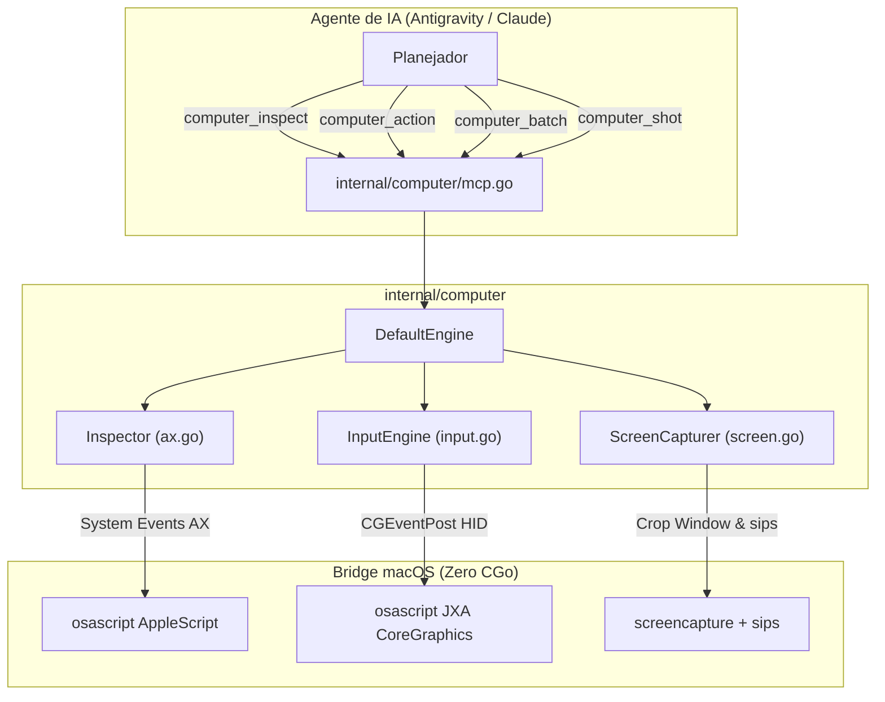

# Especificação Canônica 12: Computer Use Engine (Accessibility-First & Fallback Visual)

> **Status:** Ativa · **Dono:** Tiago Vilas Boas  
> **Localização:** `internal/computer/` · **CLI:** `agyo computer`  
> **Padrão Arquitetural:** Outer Harness (Guia x Sensor) · Hybrid Perception · Pure Go stdlib (`CGO_ENABLED=0`)

---

## 1. Visão Geral e Motivação

O **`agyo`** atua como operador e runtime da máquina para o Google Antigravity e agentes de IA.
Enquanto o módulo `browser` supervisiona o Google Chrome isolado via protocolo CDP (porta 9222), o módulo **`computer`** expande essa fronteira para o **sistema operacional desktop inteiro**: janelas nativas, aplicativos (Slack, Terminal, Finder, IDEs, etc.), menus do sistema e caixas de diálogo.

### A Dor das Implementações Ingênuas de Computer Use
Soluções baseadas em força bruta visual (estilo demo de referência da Anthropic) capturam screenshots da tela inteira a cada ação. Esse modelo tem gargalos graves:
1. **Vision Tax / Custo Extremo:** 15 passos de automação consomem ~35.000 a 50.000 tokens de visão.
2. **Latência de Inferência:** Enviar imagens PNG de 2MB a 6MB adiciona de 4 a 8 segundos a cada turno.
3. **Imprecisão de Cliques:** Alucinações de visão e divergências em monitores Retina (2x/3x) causam cliques fora do alvo.

### A Solução da Spec 12: Pirâmide de Percepção Híbrida
O `agyo` adota uma arquitetura em camadas inspirada no estado da arte (`agent-desktop` da Vercel Labs, `axcli` e Microsoft OmniParser):
* **Nível 1 (Default - 80% das ações):** Inspeciona a **Accessibility Tree (`AXUIElement`)** do macOS em texto puro, identificando elementos interativos, rótulos e caixas delimitadoras exatas. Custo: ~200 tokens de texto e latência < 150 ms.
* **Nível 2 (Fallback Visual - 20% das ações):** Quando a janela for puramente gráfica (canvas/jogos) ou a verificação visual for solicitada, captura exclusivamente a janela ativa (`screencapture -R`) e aplica compressão e downsampling nativo via `sips` (JPEG 1280px a 70%), reduzindo o payload em mais de 85%.

---

## 2. Princípios de Engenharia

1. **Zero CGo e Compilação 100% Estática (`CGO_ENABLED=0`):**
   * Em conformidade com a regra estrita do `agyo`, nenhuma biblioteca C dinâmica externa é importada.
   * A ponte com as APIs de acessibilidade e CoreGraphics do macOS é realizada via `osascript` nativo (AppleScript e JavaScript for Automation / JXA), presente em 100% dos Macs.
2. **Action Batching (Execução por Macros):**
   * O motor aceita sequências atômicas de ações (ex: focar, clicar, digitar e acionar atalhos) em um único turno, eliminando idas e vindas de rede.
3. **Context Pruning no MCP:**
   * O servidor MCP stdio encoraja o uso preferencial da inspeção textual e devolve snapshots estruturados com tags de referência únicas (`ref_1`, `ref_2`).

---

## 3. Arquitetura do Subsistema



---

## 4. Contrato da CLI (`agyo computer`)

```text
agyo computer <subcommand> [options]

Subcommands:
  inspect [--json]              Inspeciona a janela ativa e extrai a árvore semântica
  shot [options] [out_file]     Captura print otimizado (JPEG 1280px padrão)
                                Opções: --window (padrão), --screen, --format=jpeg|png, --quality=75
  click <ref|x> [y] [flags]     Clica em elemento por ref (ex: ref_1) ou coordenadas (x y)
                                Flags: --double, --right
  move <x> <y>                  Move o cursor do mouse para coordenadas absolutas
  type "<text>"                 Digita string no elemento focado
  key "<key_combo>"             Aciona tecla ou atalho (ex: return, esc, cmd+space, cmd+c)
  batch '<json_array>'          Executa lote atômico de ações (macro) em uma chamada
  mcp                           Inicia servidor Model Context Protocol (MCP) stdio
```

---

## 5. Ferramentas MCP Expostas (`agyo computer mcp`)

| Ferramenta | Parâmetros | Descrição |
| :--- | :--- | :--- |
| `computer_inspect` | `{}` | Retorna a árvore semântica compacta da janela ativa em texto plano (~200 tokens). |
| `computer_action` | `action`, `ref`, `x`, `y`, `text`, `key` | Dispara ação individual no SO (clique por ref ou coord, digitação, atalho). |
| `computer_batch` | `actions: []Action` | Executa sequência ordenada de ações em lote. |
| `computer_shot` | `window_only`, `format`, `max_width`, `quality` | Retorna screenshot comprimido em base64 e caminho em disco. |
